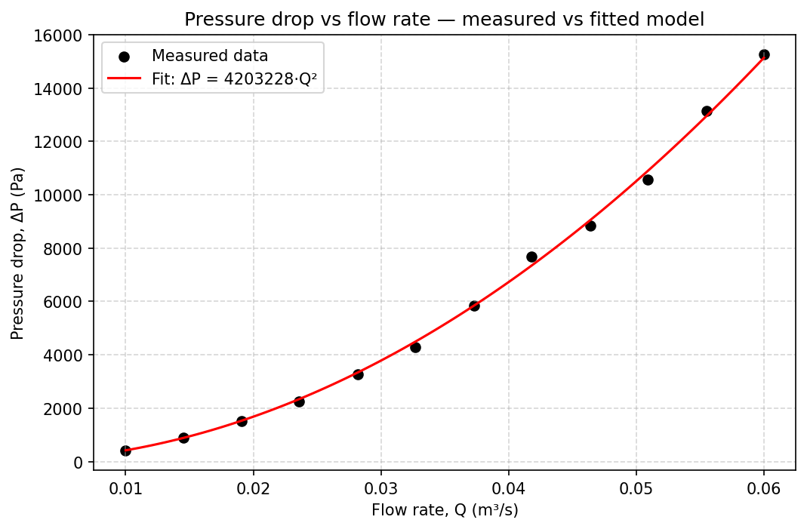

# Flow Rate vs Pressure Drop — Data Analysis

A Python script that reads experimental flow measurements, fits a model to them, and checks how well the model matches the data.

## About

I made this to keep improving my Python, this time focusing on handling data and making plots with pandas and matplotlib. It follows on from my pipe pressure drop calculator. In that project I predicted pressure drop from theory. Here I go the other way and take measured data to see whether it actually follows the physics I'd expect.

## What it does

- reads a CSV of measured flow rate and pressure drop
- fits the expected model, ΔP = k·Q², using least squares
- works out an R² value to see how good the fit is
- plots the measured points with the fitted curve and saves the figure

## The engineering behind it

For turbulent pipe flow, pressure drop should go up with the square of the flow rate (ΔP ∝ Q²). This is because the Darcy–Weisbach pressure drop depends on velocity squared, and velocity is proportional to flow rate. The script tests this by fitting ΔP = k·Q² to the data and checking the quality of the fit.

## Result

The fit matched the data well, with an R² of 0.9986, so the measured pressure drop does follow the expected square-law relationship with flow rate.

## How to run it

Needs Python with pandas, matplotlib and numpy (all come with Anaconda).

1. Keep `data_analysis.py` and `flow_data.csv` in the same folder.
2. Run `data_analysis.py`.
3. It prints the fitted coefficient and R², and saves `pressure_drop_plot.png`.

## Files

- `data_analysis.py` — the analysis script
- `flow_data.csv` — the dataset (flow rate, pressure drop)
- `pressure_drop_plot.png` — the output plot

## Things I might add later

- try other models and compare them
- add error bars from repeated measurements
- load more than one dataset to compare different pipes or fluids
